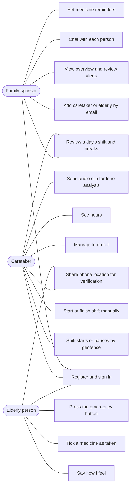
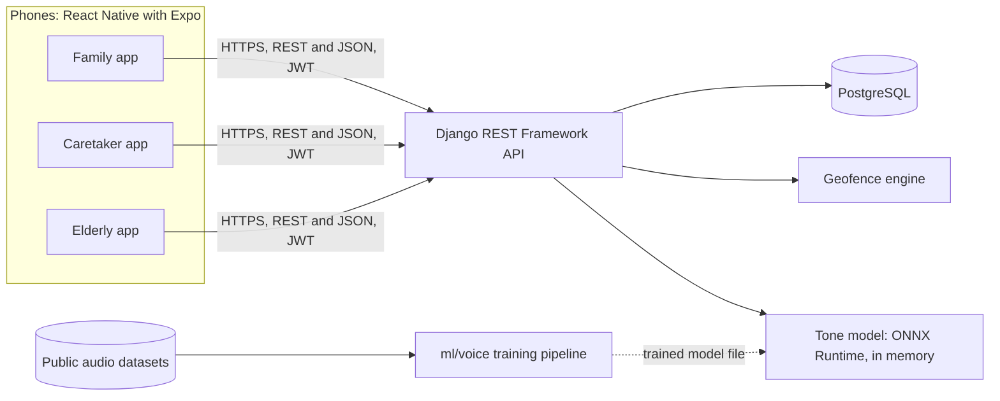
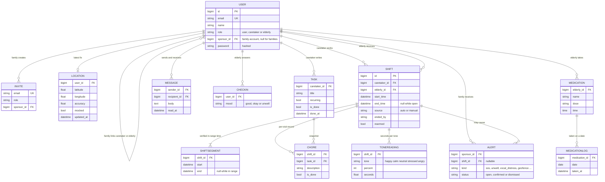
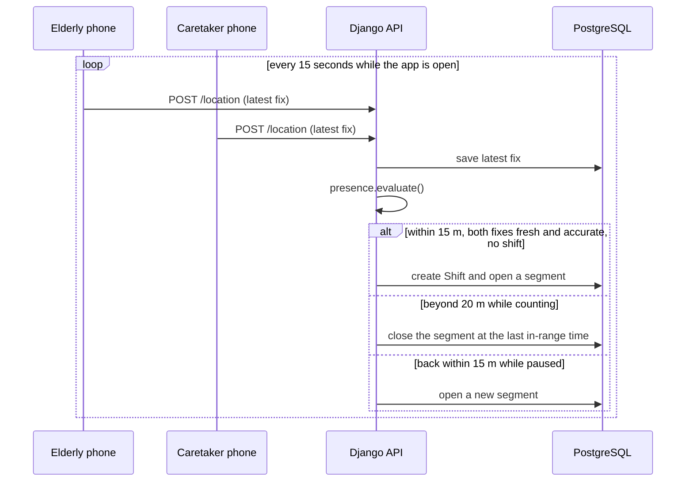
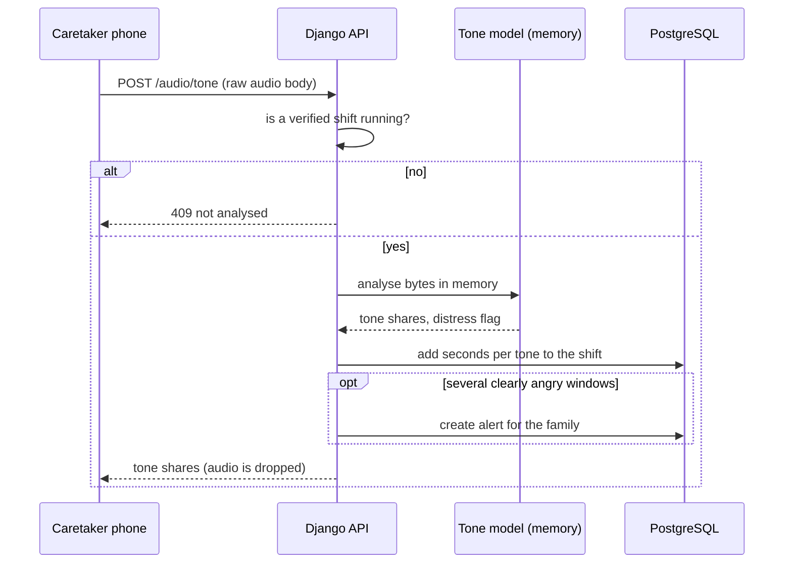
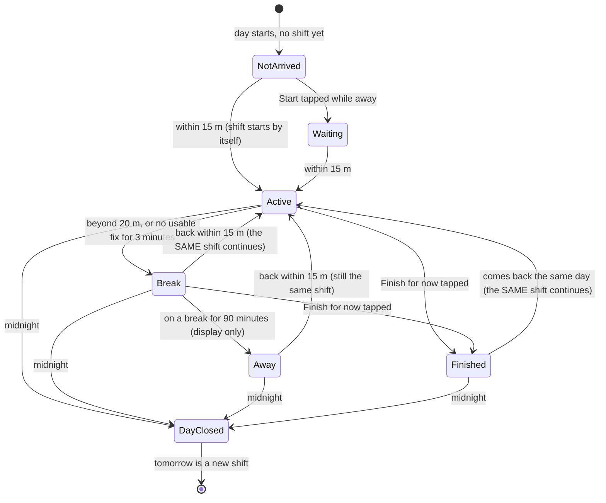

# Chapter 4: System Analysis and Design

*MzaziCare: a mobile-first, AI-enhanced elderly care monitoring system.*
This chapter describes the analysis and design that guided the implementation, **as the system is actually built**. Where it differs from the
proposal, the reason is given and the change is listed in [proposal-corrections.md](proposal-corrections.md). Diagrams are written in
Mermaid and render on GitHub and in VS Code.

## 4.1 Introduction

The proposal identified a trust gap: families who live far from an elderly parent hire informal caretakers they cannot supervise, and existing products watch the
patient rather than verify the caretaker. The solution is a software-only system that uses the phones the people already own to (1) verify that a caretaker is present,
(2) record their hours and tasks, (3) judge the tone of a visit without storing audio, and (4) keep a human in the loop: the software raises flags and a person
decides. During development a third kind of user, the elderly person, turned out to need an app of their own, so the system has three roles instead of two.

Development followed Agile Scrum as a solo developer, in short increments, each tested before the next began. The dated record of every step is in
[DEVELOPMENT_LOG.md](../DEVELOPMENT_LOG.md).

## 4.2 System analysis

### 4.2.1 Stakeholders and actors

| Actor | Who | Goals | Interacts through |
|---|---|---|---|
| **Family sponsor** (role `user`) | an adult child, often abroad | know the parent is cared for; be alerted early; keep control | mobile app (Overview, Chats, People) |
| **Caretaker** (role `caretaker`) | the hired helper | have hours counted fairly; manage the day's tasks; reach the family | mobile app (Shift, Tasks, Hours) |
| **Elderly person** (role `elderly`) | the parent | feel safe; call for help easily; understand the screen | mobile app (large-text, bilingual home) |
| **Tone model** | software | classify the tone of a recording clip | called by the backend, not an actor with a screen |
| **Geofence engine** | software | decide whether the caretaker is within range | runs inside the backend |

Everyone registers as an ordinary account. A family account adds an email as a caretaker or elderly person; that account (existing, or created later with that email) takes that role and
is linked to the family. This is the role-based access control (RBAC) of the system.

### 4.2.2 Functional requirements

IDs FR-01 to FR-05 come from the proposal; FR-06 onward were identified during development.

| ID | Requirement | Status |
|---|---|---|
| FR-01 | Register, sign in, and role-based access; a family links its caretaker and elderly person | **Implemented** |
| FR-02 | Caretaker starts and ends shifts and keeps a task list; a record of the visit exists | **Implemented**: shifts start automatically (geofence) or manually; own to-do list with daily-repeating tasks |
| FR-03 | Triage chatbot answering mixed English and Kiswahili first-aid queries | **Not started** |
| FR-04 | Listen to the visit, extract features, delete raw audio, flag vocal distress | **Model and endpoint implemented** (tone model, in-memory analysis, alert for the family). Recording from the phone is **pending** (consent flow first) |
| FR-05 | Monitor GPS against a geofence; flag manipulated coordinates | **Implemented** (15 m around the elderly person's phone; fake-GPS reports ignored and flagged) |
| FR-06 | The family reviews a dashboard and confirms or dismisses alerts | **Implemented** (human in the loop) |
| FR-07 | Separate private chats between the family and each caretaker and elderly person | **Implemented** |
| FR-08 | Elderly home: caretaker presence, mood check-in, medicine reminders and ticks, emergency button | **Implemented** |
| FR-09 | Caretaker sees verified hours (day, week, month, total) and shift history | **Implemented** |
| FR-10 | Elderly screen usable by older people: large text, English and Kiswahili | **Implemented** (translation to be reviewed by a native speaker) |
| FR-11 | Behavioural anomaly detection on visit patterns | **Not started** |

### 4.2.3 Non-functional requirements

| ID | Requirement | How it is met, and evidence |
|---|---|---|
| NFR-01 Security | Backend-issued JWT, role-scoped access, no third-party login | JWT (90 days) from the Django backend; every endpoint checks the role (tested: 123 backend tests including 403/401 cases); passwords hashed; no third-party login or API keys |
| NFR-02 Performance | Heavy AI asynchronous, normal interactions within 2 s | **Partly.** The tone model is small (about 0.5 MB, runs on a CPU) and runs inside the request; there is no task queue yet. A formal latency benchmark has **not** been done |
| NFR-03 Usability | Understands conversational Kenyan phrasing | The chatbot is not built. The elderly screen is bilingual with plain-language wording |
| NFR-04 Accuracy | Each model at least 80 % before deployment, precision prioritised | Tone model: **83.0 %** overall on unseen speakers, **75.4 %** on speech alone (below 80 %); alert rule tuned for precision. Other models not built |
| Privacy | KDPA; raw audio not stored | Audio analysed in memory only; latest location only; see 4.3.7 and [DATA.md](DATA.md) |
| Maintainability | Clear structure, repeatable setup, tests | Scripts for setup, run, data and tests; 123 backend + 24 ML tests; documented |

### 4.2.4 Use cases

Key scenarios:

* **UC-A, link a caretaker.** The family enters an email and role. If an account exists it is converted and linked; otherwise an invite is stored and applied when that person registers. Both end up on their own home screen.
* **UC-B, automatic shift.** Both phones report their location every 15 s. When the caretaker is within 15 m of the elderly person's phone, the day's shift starts. If they step beyond 20 m the timer stops at the last moment they were seen in range and a **break** is recorded; when they return, the **same shift** continues. The next day is a new shift.
* **UC-E, review a day.** The caretaker or the family opens a day's shift and sees when the caretaker arrived, every break (when they stepped out, when they came back, how long), when they left, the active time and the chores. The family also sees the tone of that visit.
* **UC-C, emergency.** The elderly person presses the red button and confirms. The family gets an emergency alert and a chat message, and the caretaker's screen shows an emergency banner.
* **UC-D, tone check.** During a verified shift the caretaker's phone sends a short clip; the server classifies it in memory and adds to the visit's tone totals. If several windows are clearly angry the family gets an alert to review.

### 4.2.5 Constraints and assumptions

* One developer; laptop with a 4-core CPU and no GPU, so models are kept small and trained on CPU.
* The app is developed and tested in Expo Go. Background location needs a development build.
* Public emotional-speech datasets are acted English speech from adults.
* Urban Kenya (Nairobi), Android and iOS, a closed pilot. Out of scope: facial recognition, employing caretakers, a full medical record, wearable hardware.

## 4.3 System design

### 4.3.1 Architecture

N-tier and decoupled: thin clients, one API, one database. The geofence engine and the tone model run inside the API process today; the model is a separate
file loaded through ONNX Runtime, so it can later move to its own service without changing the API.

### 4.3.2 Technology choices

| Layer | Choice | Why |
|---|---|---|
| Mobile | React Native + Expo, TypeScript | one codebase for Android and iOS; Expo Go for phone testing; TypeScript catches mistakes early; matches the web dashboard |
| API | Django + Django REST Framework | mature, secure defaults (password hashing, ORM, migrations); fast to build role-based APIs |
| Auth | SimpleJWT | stateless, backend-issued tokens as required by NFR-01; 90-day lifetime for "stay signed in" |
| Database | PostgreSQL | reliable relational store; PostGIS is installed for future spatial queries |
| AI training | PyTorch (CPU) | flexible; the model is small enough for a laptop |
| AI serving | ONNX Runtime | small dependency, fast CPU inference, no PyTorch in production |
| Features | NumPy and SciPy MFCC | one implementation shared by training and serving, so no mismatch |

### 4.3.3 Data design

Design decisions:

* **One `USER` table with a role and a self-link `sponsor_id`**, instead of separate Sponsor, Caretaker and Patient tables. The elderly person has their own login, and role conversion
  is a single field change. A family owns many caretakers and many elderly people.
* **`SHIFTSEGMENT`** holds only the time the caretaker was verified in range; worked time is the sum of segments. That makes manual start/stop and pauses honest: unverified time never counts.
* **`LOCATION` keeps only the latest fix** per phone: enough to verify presence, with no movement trail to leak.
* **`ALERT`** replaces the proposal's `AnomalyLog`. It is linked to a shift only when relevant and has a status, which is the human decision recorded for later retraining.
* **`TONEREADING` stores derived totals only.** There is no audio table.

### 4.3.4 Behaviour

Automatic shift (UC-B):

Tone analysis (UC-D):

A shift is **one day** of work. Stepping out of range is a *break*: it never ends the shift, and the same shift continues when the caretaker returns. A new calendar day starts a new shift.

Both the caretaker and the family can open any day's shift and see its timeline: when the caretaker arrived, each time they stepped out and came back (with the length of the break),
and when they left. Active time is the sum of the in-range periods; breaks are not counted.

### 4.3.5 Geofence design

The proposal described a fixed 30 m circle around a stored home address, scored by a reinforcement-learning agent. The implementation instead centres the circle **on the elderly person's phone**
and uses a deterministic rule, because (a) the elderly person may not be at the stored address, (b) a rule is explainable and testable, and (c) it works without a trained model.

| Parameter | Value | Reason |
|---|---|---|
| Enter radius | 15 m | the project's requirement |
| Exit radius | 20 m | hysteresis: GPS jitter at the edge must not flap the timer |
| Location freshness | 120 s | an old fix is ignored |
| Accuracy limit | 40 m | a worse fix cannot verify a 15 m rule |
| Stale pause | 180 s | no usable fix for this long starts a break at the last moment seen in range |
| Flicker merge | 120 s | coming back within 2 minutes of leaving is GPS noise, not a break |
| Shift length | one calendar day (Nairobi) | stepping out is a break and never ends the shift; a long break (90 min) is only shown as "away" |
| Day change | closes the old shift at midnight and starts a new one | if the caretaker was still there at midnight, the new shift carries on from 00:00; an empty shift (never arrived) is discarded |
| After "Finish for now" | no automatic restart until the caretaker has left range; if they come back the same day the same shift continues | stops an instant restart without losing the day's record |
| Fake GPS | ignored and flagged to the family | the phone reports mock-location fixes |

Limits: two phones can read 10 to 20 m apart indoors; location is shared only while the app is open.

### 4.3.6 Acoustic AI design

* **Task:** classify 3-second windows into happy, calm, neutral, stressed, angry, or *noise* (not a person speaking).
* **Features:** 40 MFCC x 149 frames at 16 kHz, level-normalised (the same code in training and serving).
* **Model:** small 2D CNN (about 126 k parameters), trained on CPU, exported to ONNX. It was chosen after a fair comparison of
  four models on the same data and unseen speakers. Each model had the conditions that suit it best:
  * Its natural input: MFCC frames for the neural networks. For the classical models, 1,680 MFCC + delta functionals,
    which describe how the voice changes across the window.
  * A settings search on the validation speakers.
  * The same training budget for both networks.
  * The same temperature calibration.
  * Its own anger-alert rule chosen on validation, with at most 1 % false alarms.

  | Model | Speech accuracy | Speech macro-F1 | Heated arguments caught (false alarms), own rule | Calibration error | Time per window | Size | Verdict |
  |---|---|---|---|---|---|---|---|
  | **2D CNN on the MFCC image** | **75.4 %** | **0.706** | **97.1 % (1.1 %)** | **0.017** | **1.4 ms** | **0.5 MB** | **Deployed** |
  | BiLSTM + attention on the MFCC sequence | 68.6 % | 0.614 | 91.7 % (0.8 %) | 0.059 | 2.0 ms | 0.6 MB | Reserve: same interface, 7 points behind |
  | Random forest on MFCC functionals | 64.3 % | 0.563 | 89.8 % (1.8 %) | 0.042 | 147 ms | 50.2 MB | Not suitable: most false alarms, slowest, largest |
  | SVM (RBF) on MFCC functionals | 63.7 % | 0.559 | 69.6 % (0.4 %) | 0.031 | 12.7 ms | 7.4 MB | Baseline only |

  Under equal conditions the CNN still leads on every tone and on both acted datasets. Its probabilities are the most
  trustworthy for the precision-first alert, and it is the smallest and fastest model.

  The richer, time-aware features raised the classical models' validation scores but not their test scores on unseen
  speakers. Calibration fixed the random forest's earlier failure to raise alerts. Neither change closed the gap, so the
  CNN's lead is not an artefact of the setup.

  Full table: [`ml/voice/artifacts/comparison.md`](../ml/voice/artifacts/comparison.md).
* **Data:** RAVDESS, CREMA-D, LibriSpeech, ESC-50 ([DATA.md](DATA.md)); splits by speaker.
* **Evaluation (unseen speakers):** 83.0 % overall, 75.4 % on speech alone; angry precision 71 %, stressed 75 %; the live path scores the same as the offline test.
* **Alert rule (precision first):** an "angry voices" alert needs at least 3 windows in one clip with at least 60 % angry probability. Simulated on whole recordings: 0.2 % false alarms, 95 % of heated arguments caught, 44 % of mild ones.
* **Service-quality rating:** from the share of stressed plus angry speech (at most 15 % good, at most 30 % fair, otherwise needs attention). Everyday speech is mostly neutral, so "not enough happy" does not count against anyone.
* **Human in the loop:** the family confirms or dismisses each alert; those decisions are the labels for the next training round.

Full model card: [`ml/voice/README.md`](../ml/voice/README.md).

### 4.3.7 Security and privacy design

| Concern | Design |
|---|---|
| Who may do what | Role checked on every endpoint (matrix in [API.md](API.md)); chat only between a family and the people it linked; a person can only read their own data |
| Authentication | Backend-issued JWT; passwords hashed (PBKDF2); 90-day sessions. Limitation: logging out clears the token on the phone but there is no server-side revocation yet |
| Spoofed location | Mock-location fixes ignored and reported; accuracy and freshness checks; the elderly phone is the reference, so the caretaker cannot move the circle |
| Audio | Raw body, in-memory upload handler only, analysed and dropped; only seconds-per-tone saved; analysed only during a verified shift; size limit; capture switched off until a consent flow exists |
| Location privacy | latest fix only; the caretaker sees a distance (up to 500 m), never the elderly person's position |
| False alarms | cautious alert rule, rate limits (one alert per kind per period), and a human decides |
| Secrets | none in Git; `.env` files ignored; secret scan in the test script |
| Input validation | every endpoint validates its input and returns 400 on bad data (tested) |

### 4.3.8 User-interface design

* One mobile app, one home screen per role (RBAC), so no one sees controls that are not theirs.
* A consistent palette: deep teal `#1F6F5F`, warm off-white background `#F8F6F1`, with amber and red reserved for warnings and emergencies; the system font; one icon family.
* **Elderly screen:** large text with three sizes, English or Kiswahili, one action per card, plain wording, and an always-visible red emergency button with a confirmation step.
* **Caretaker screen:** Shift, Tasks and Hours tabs; the shift state is explained in words ("Your timer resumes by itself when you are back within 15 m").
* **Family screen:** Overview, Chats, People; before any caretaker is linked it shows a checklist and a preview of what will appear.

### 4.3.9 Testing strategy and results

| Level | What | Result |
|---|---|---|
| Unit | geofence engine with controlled time; recurring-task rules; MFCC and windowing; label mapping and speaker-disjoint splits | passing |
| API / integration | registration, role linking, access control, shift, tasks, chat, elderly features, dashboard, tone endpoint | **123 backend tests**, passing |
| ML | held-out speakers; live-path check; alert-rule simulation; end-to-end check of the audio endpoint | figures in 4.3.6 |
| Static | TypeScript type-check; migration consistency; secret scan | passing (`scripts/test.ps1`) |
| Manual | app on a physical phone with Expo Go | role flows, chat, elderly screen |

Not yet done: formal performance benchmark (NFR-02), usability testing with real elderly users, a two-phone field test of the geofence in a real home, and any test of tone accuracy on real, consented recordings.

## 4.4 Implementation status against the proposal

See [proposal-corrections.md](proposal-corrections.md) for the full list. In short: authentication and roles, the geofence, the dashboard, the elderly app and the tone model are built;
the web dashboard for the family, phone audio capture (with consent) and the live tone view are built too; the chatbot, the behavioural anomaly model, push notifications and offline sync are not.

## 4.5 Limitations and future work

1. Consent flow, then phone audio capture (and an audio-format decision for Android).
2. Triage chatbot (mBERT) and Kiswahili/English code-switching.
3. Background location (development build) and push notifications.
4. Tune the tone model on consented real recordings; review the Kiswahili text with a native speaker.
5. Behavioural anomaly detection; Celery task queue; deployment, hardening and a data protection impact assessment.
